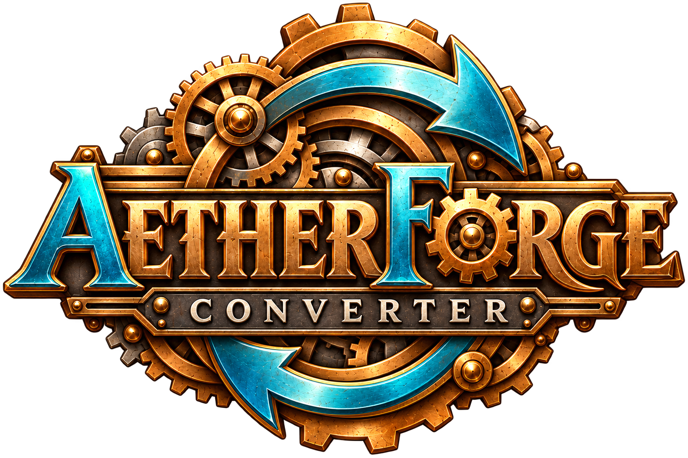
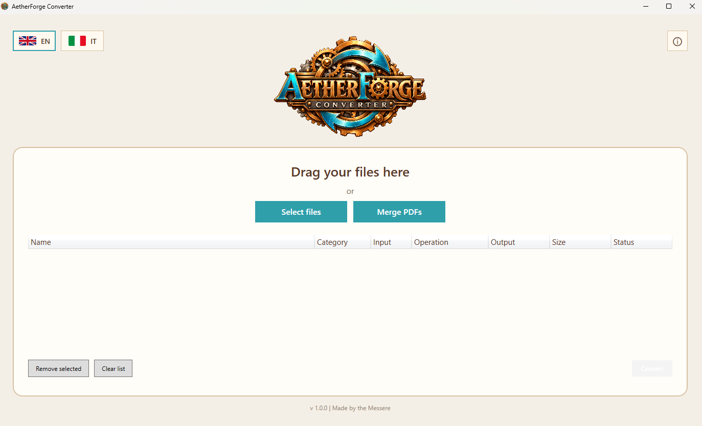
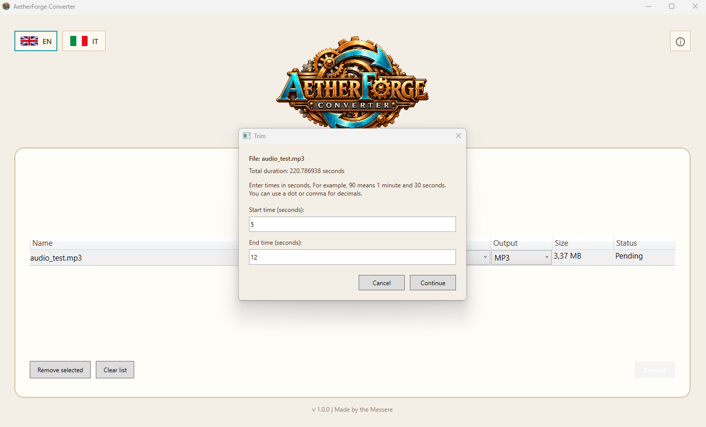
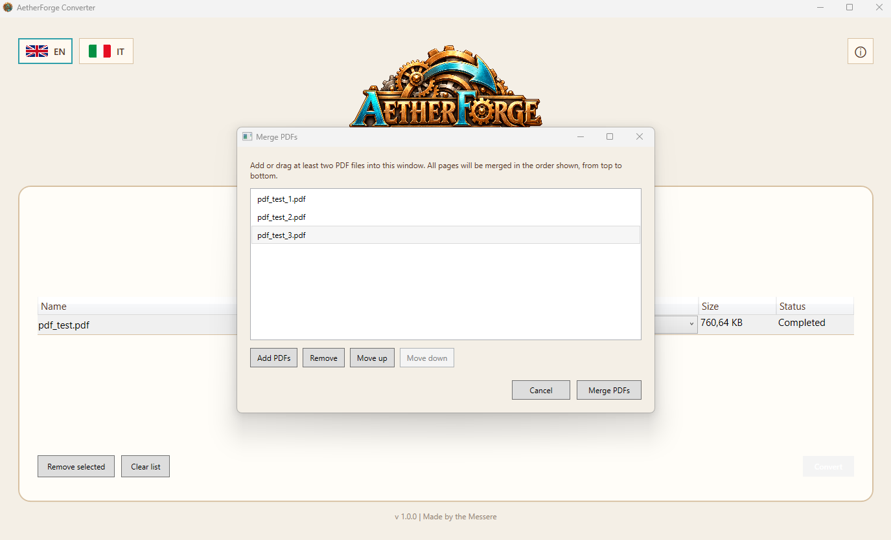

<p align="center">
  
</p>

<h1 align="center">AetherForge Converter</h1>

<p align="center">
  A Windows application for converting and processing images, audio, video, and documents.
</p>

<p align="center">
  <a href="https://aetherforgeconverter.pages.dev/en/" target="_blank" rel="noopener noreferrer">Website</a> ·
  <a href="https://github.com/matteo-ferranti/AetherForge/releases" target="_blank" rel="noopener noreferrer">Releases</a> ·
  <a href="https://github.com/matteo-ferranti/AetherForge/issues" target="_blank" rel="noopener noreferrer">Report an issue</a> ·
  <a href="README.it.md">Italiano</a>
</p>

---

## Overview

AetherForge brings file conversion and practical editing tools into a single desktop application. It supports individual files and batch processing, with an interface available in English and Italian.

Processing takes place locally on your computer. You do not need to upload files to an online conversion service. The installer includes the .NET runtime and the processing components used by the application.

## Features

| Category | Available tools |
| --- | --- |
| Images | Format conversion, resizing, rotation, flipping, quality adjustment, and metadata removal for supported formats. |
| Audio | Format conversion, trimming, bitrate adjustment for supported formats, and metadata removal. |
| Video | Format conversion, trimming, audio extraction, audio removal, GIF creation, and metadata removal. |
| Text documents | Conversion between supported text and office formats, PDF text extraction, and PDF export. |
| Spreadsheets | Conversion between supported spreadsheet formats, PDF export, and CSV export with worksheet selection. CSV input can be exported to PDF. |
| Presentations | Conversion between PPT, PPTX, and ODP, plus PDF export. |
| E-books | EPUB conversion to TXT and PDF. |
| PDF tools | Merge files in a chosen order and extract selected pages or page ranges. |

The file list also provides drag and drop, per-file operation and output selection, processing status, and buttons to open completed results or show them in their folder.

## Screenshots

### Main window

Add files, choose operations and output formats, and track processing results.



### Audio trimming

Select the start and end times of the audio segment to export.



### PDF merging

Add PDF files and arrange their order before merging them.



## Format examples

| Category | Examples of accepted inputs | Conversion outputs |
| --- | --- | --- |
| Images | JPG, PNG, WebP, GIF, BMP, TIFF, AVIF, HEIC, HEIF, ICO, SVG | JPG, PNG, WebP, BMP, TIFF, AVIF |
| Audio | MP3, WAV, FLAC, AAC, M4A, OGG, OPUS, WMA, AIFF, AC3 | MP3, WAV, FLAC, AAC, M4A, OGG, OPUS |
| Video | MP4, MKV, AVI, MOV, WebM, WMV, FLV, MPEG, TS | MP4, MKV, MOV, WebM, AVI |
| Documents | PDF, TXT, DOC, DOCX, ODT, RTF, HTML, EPUB | Available outputs depend on the input format |
| Spreadsheets | XLS, XLSX, ODS, CSV | Available outputs depend on the input format |
| Presentations | PPT, PPTX, ODP | PDF and supported presentation formats |

These lists do not imply that every format can be converted to every other format. The application shows the operations and outputs available for each input.

## Installation

**Target platform:** Windows 11 on an Intel or AMD x64 processor.

[**Download AetherForge 1.0.0 — Windows x64 installer**](https://github.com/matteo-ferranti/AetherForge/releases/download/v1.0.0/AetherForge-Setup-1.0.0-win-x64.exe)

1. Download the installer using the link above.
2. Run `AetherForge-Setup-1.0.0-win-x64.exe`.
3. Select English or Italian and follow the installation steps. English is selected by default.
4. Open AetherForge from the Start menu or the optional desktop shortcut.

Installation is per user and does not request administrator privileges. No separate .NET, FFmpeg, LibreOffice, or qpdf installation is required.

To uninstall, use **Settings → Apps → Installed apps → AetherForge**.

The current installer targets Windows 11 x64. Windows 10 and ARM compatibility have not been verified.

[FFmpeg sources and build scripts](https://github.com/matteo-ferranti/AetherForge/releases/download/v1.0.0/AetherForge-FFmpeg-Sources-20261009.zip) are provided separately and are not required to use the application.

## Getting started

1. Drag files into the main window or use **Select files**.
2. Choose an operation and an available output format for each file.
3. Set any options required by the operation.
4. Start processing and choose where to save the results.
5. Check the status of each file, then open the result or its folder.

PDF merging uses a separate window where you can add files, arrange their order, and choose an output destination.

## Processing safeguards and limitations

AetherForge includes checks against overwriting input files, temporary output staging for supported processing workflows, image and archive resource limits, and restrictions on certain external resources and active document content.

These checks do not constitute a complete sandbox or a guarantee that every input is safe.

- **PDF to TXT has no OCR:** scanned pages need a text layer for extraction.
- Office and presentation conversion may change layout, fonts, or application-specific features.
- Operations and quality settings vary by format.
- Metadata removal is available for supported formats and is not full content anonymization.
- Damaged, protected, or oversized files may be rejected.

## Release validation

The published application and installer have passed conversion, installation, and uninstallation checks on the development computer. Testing on a clean Windows installation is pending.

## Building from source

Requirements:

- Windows with the **.NET 10 SDK**.
- Compatible x64 processing tools in the following locations:

```text
tools/
├── ffmpeg/
│   ├── ffmpeg.exe
│   └── ffprobe.exe
├── libreoffice/
│   └── program/soffice.com
└── qpdf/
    └── bin/qpdf.exe
```

Include the complete LibreOffice and qpdf distributions and their supporting files, rather than only the executables. These tool directories are not committed to this repository.

From the repository root:

```powershell
dotnet restore .\src\AetherForge.App\AetherForge.App.csproj
dotnet build .\src\AetherForge.App\AetherForge.App.csproj -c Release
```

To publish a self-contained Windows x64 build:

```powershell
dotnet publish .\src\AetherForge.App\AetherForge.App.csproj -c Release -r win-x64 --self-contained true -p:PublishSingleFile=false -p:PublishTrimmed=false -o .\artifacts\release\win-x64
```

Keep the entire published folder together. To build the installer, open `AetherForge.iss` in **Inno Setup 7** and compile it after publishing the application.

## Components and licenses

AetherForge uses:

- **Magick.NET / ImageMagick** for image processing.
- **FFmpeg and FFprobe** for audio and video processing.
- **LibreOffice** for office document conversion.
- **PdfPig** for PDF text extraction.
- **Open XML SDK** for supported Office document operations.
- **qpdf** for PDF processing.
- **Noto Sans** for text rendering in generated documents.

AetherForge's original code is licensed under the **[MIT License](LICENSE)**. Third-party components retain their own licenses and copyright notices.

License texts and notices are available in `src/AetherForge.App/Assets/Licenses` and in the application's **About and licenses** window. Redistributing bundled components also requires compliance with their own licenses, including applicable corresponding-source obligations.

## Author and attribution

Created by **Matteo Ferranti**.

If you use AetherForge or its code in your project, a visible credit to the author and a link to this repository are appreciated. This is a request, not an additional condition of the MIT License.

## Feedback and contributions

Suggestions, reproducible bug reports, and contributions are welcome through [GitHub Issues](https://github.com/matteo-ferranti/AetherForge/issues) and pull requests.

When reporting a problem, include the Windows version, AetherForge version, input and output formats, operation, and error message. Share a non-sensitive sample only when necessary.


